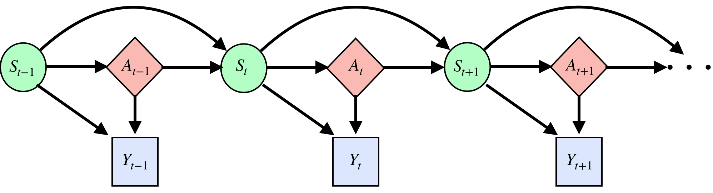
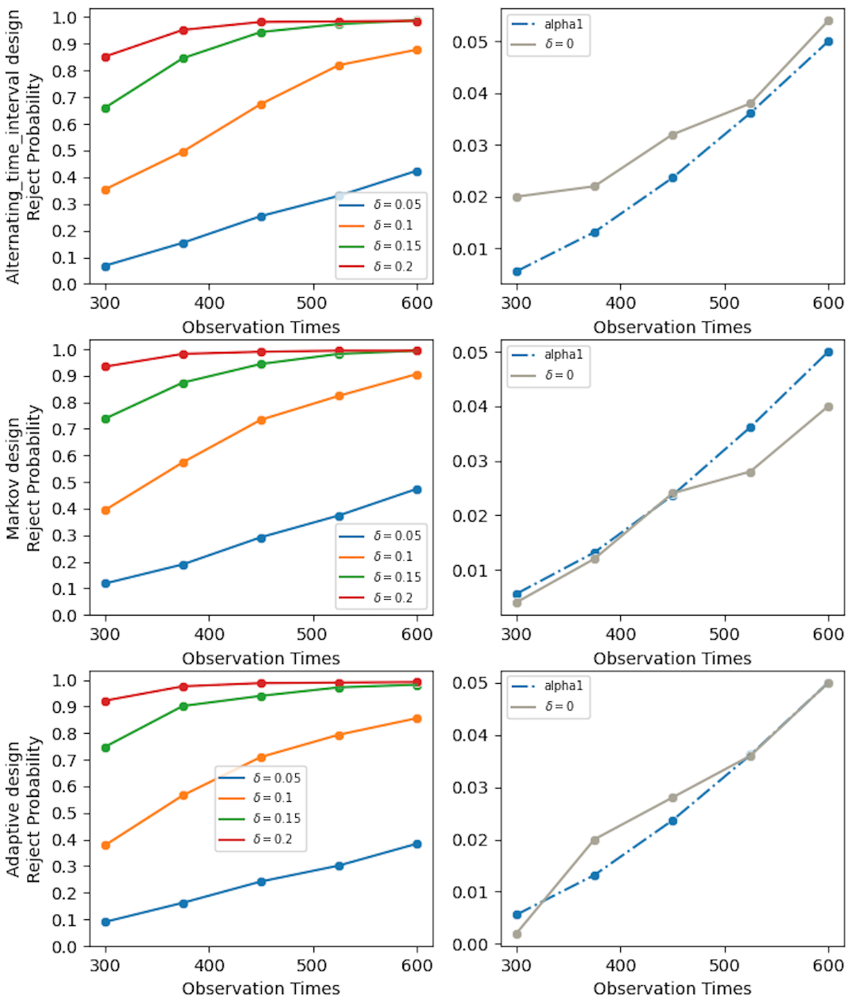
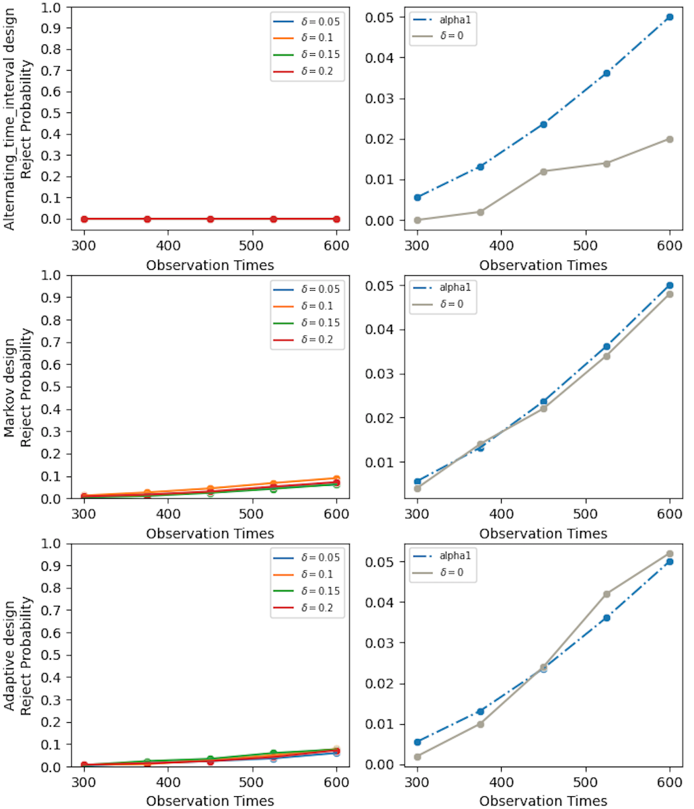
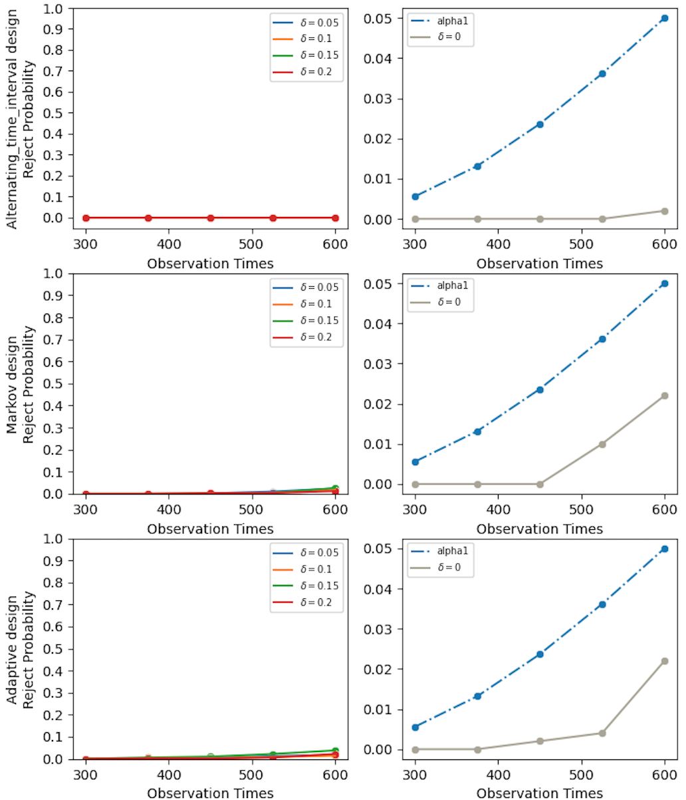

# Dynamic Causal Effects Evaluation in A/B Testing with a Reinforcement Learning Framework (CausalRL)

This repository contains the implementation for the paper ["Dynamic Causal Effects Evaluation in A/B Testing with a Reinforcement Learning Framework"](https://arxiv.org/pdf/2002.01711.pdf) in Python. 

## Summary of the paper

A/B testing, or online experiment is a standard  business strategy to compare a new product with an old one in pharmaceutical, technological, and traditional industries.  Major challenges arise in online experiments of two-sided marketplace platforms (e.g., Uber) 
where there is only one unit that receives a sequence of treatments over time. In those  experiments, the treatment at a given time   impacts  current outcome as well as future outcomes. The aim of this paper is to  introduce a reinforcement learning framework for carrying A/B testing in these experiments, while characterizing the long-term treatment effects. Our proposed testing procedure allows for sequential monitoring and online updating. It is generally applicable to a variety of treatment designs in different industries. In addition, we systematically investigate the theoretical properties (e.g., size and power) of our testing procedure. Finally, we apply our framework to both simulated data and a real-world data example obtained  from a technological company to illustrate its advantage over the current practice. 



**Figure 1**: Causal diagram for MDP under settings where treatments depend on current states only. Solid lines represent causal relationships. 

<p float="left">
 


</p>

**Figure 2**: Empirical rejection probabilities of our test (left), the two-sample t-test (middle) and the modified version of the O'Brien \& Fleming sequential test (right). Settings correspond to the alternating-time-interval, adaptive and Markov design, from top plots to bottom plots.


## File Overview
- `src/`: This folder contains all python codes used in numerical experiments.
  - `conf.py` sets true parameters and functions used in estimation for one experiment.
  We use `<verison>` as the key of a python dict to represent one numerical experiment.
  - `main.py` is an entrance to be used in command line.
  We can type `python main.py <version> 0` to start a new experiment and type
  `python main.py <verison> 1` to see the result if the experiment has executed.
  - `_analyzer.py` contains the functions to make tables and draw plots.
  - `_monitor.py` is a platform to **realize the algorithm in our paper**, which includes the estimation part and hypothesis test part. 
- `data/`: This folder contains raw results and corresponding pics of each experiment.
  - Raw results names are like `<version>.json`.
  - Plots names are like `<version>_<parameter_used_in_estimation>.png`.
  


## Citation

Please cite our paper
["Dynamic Causal Effects Evaluation in A/B Testing with a Reinforcement Learning Framework"](https://arxiv.org/pdf/2002.01711.pdf)

``` 
@article{shi2021time,
  title={Dynamic Causal Effects Evaluation in A/B Testing with a Reinforcement Learning Framework},
  author={Shi, Chengchun and Wang, Xiaoyu and Luo, Shikai and Zhu, Hongtu and Ye, Jieping and Song, Rui},
  journal={Journal of the American Statistical Association},
  volume={accepted}
  year={2021}
}
```


## Refactored Project Structure

The project has been modernised with the following improvements:

- **Package management**: [`uv`](https://docs.astral.sh/uv/) for dependency management and virtual environments.
- **Configuration**: Experiment settings moved from hard-coded Python dicts to JSON files under `configs/`.
- **Type annotations**: All new modules include full type hints.
- **Docstrings**: NumPy-style docstrings with LaTeX equations referencing the paper.
- **No `eval()`**: The polynomial basis generator now uses closures instead of `eval()`.
- **Regression tests**: `pytest` tests verify numerical results remain unchanged after refactoring.

```
.
├── configs/                     # Experiment configuration (JSON)
│   ├── causal_rl.json           #   Main CausalRL experiment
│   ├── develop.json             #   Fast debug (200 iterations)
│   ├── t_test.json              #   Two-sample t-test comparison
│   ├── obf.json                 #   O'Brien-Fleming comparison
│   └── monte_carlo.json         #   Monte Carlo evaluation
├── data/                        # Raw results and plots
├── src/                         # uv project root
│   ├── pyproject.toml           #   Project metadata & dependencies
│   ├── uv.lock                  #   Locked dependency versions
│   ├── main.py                  #   Entry point: run_experiment()
│   ├── montecarlo.py            #   Monte Carlo entry point
│   ├── conf.py                  #   Config loader (JSON → resolved callables)
│   ├── functions/               #   Utility callables
│   │   ├── spending.py          #     Alpha spending functions
│   │   ├── simulation.py        #     State transition functions
│   │   └── policy.py            #     Decision-making policies
│   ├── monitoring/              #   Hypothesis testing monitors
│   │   ├── bootstrap.py         #     CausalRL bootstrap monitor (Algorithm 1)
│   │   ├── obf.py               #     O'Brien-Fleming baseline
│   │   ├── ttest.py             #     Two-sample t-test baseline
│   │   └── test.py              #     Lightweight stub (development)
│   ├── estimation/              #   Estimation utilities
│   │   ├── basis.py             #     Polynomial basis functions
│   │   └── _utils.py            #     xi-vector & matrix_sqrt
│   ├── analysis/                #   Plotting
│   │   └── plot.py              #     Rejection-probability plots
│   ├── generation/              #   Data generation
│   │   └── generator.py         #     MDP trajectory generator
│   ├── tests/                   #   Regression tests
│   │   └── test_regression.py   #     Numerical-reproducibility checks
│   ├── _logger.py               #   Logging setup
│   └── _*.py                    #   Backward-compatible re-exports
└── README.md
```


## Getting Started (Refactored)

### Prerequisites

- Python ≥ 3.11
- [`uv`](https://docs.astral.sh/uv/) (install with `brew install uv` on macOS)

### Setup

```bash
# Navigate to the src directory (uv project root)
cd src

# Create virtual environment and install dependencies
uv sync
```

### Running Experiments

```bash
# Fast sanity check (~10 seconds, 200 iterations)
uv run python main.py develop

# Full CausalRL experiment
uv run python main.py causal_rl

# Comparison baselines
uv run python main.py t_test
uv run python main.py obf

# Monte Carlo evaluation
uv run python montecarlo.py
uv run python montecarlo.py monte_carlo
```

Each run saves results to `data/<version>.json` and generates rejection-probability plots.

### Running Tests

```bash
uv run pytest tests/ -v
```

### Adding a New Experiment

1. Create a JSON config under `configs/` (use an existing file as template).
2. Function/class references use string names registered in `conf.py`.
3. Run: `uv run python main.py <config-name>`

### Code Quality

```bash
uv run ruff check .
``` 
